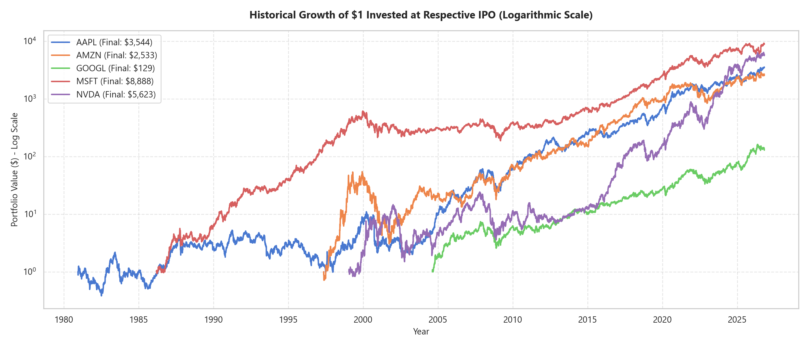
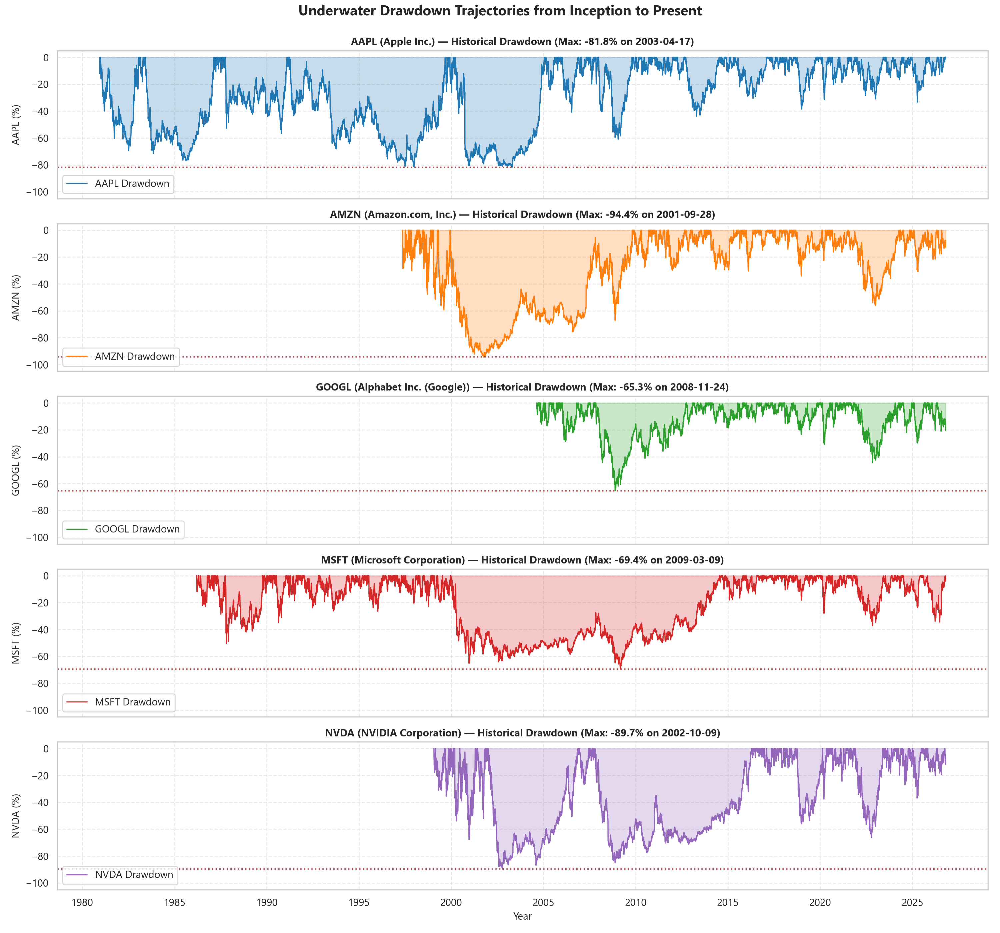
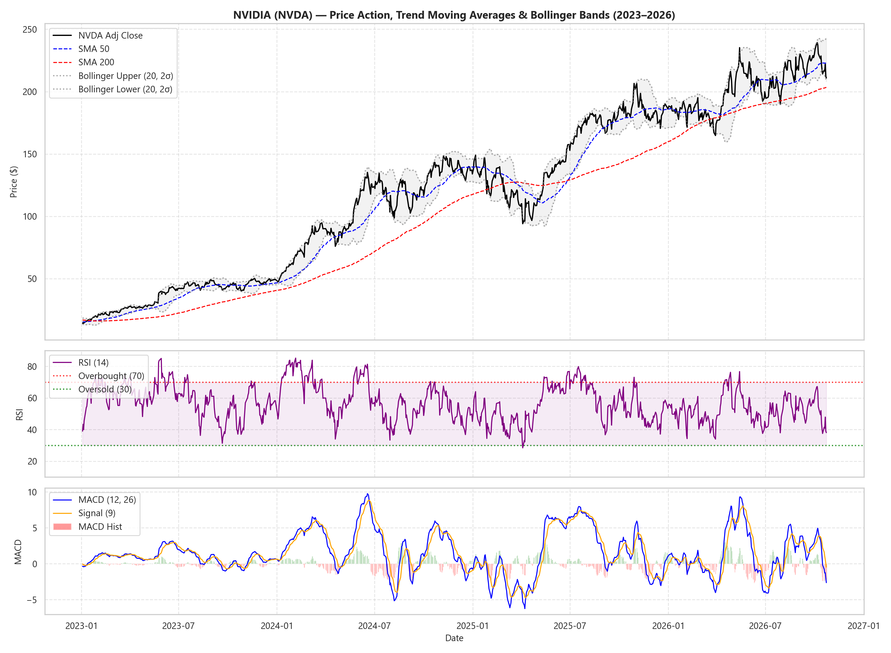
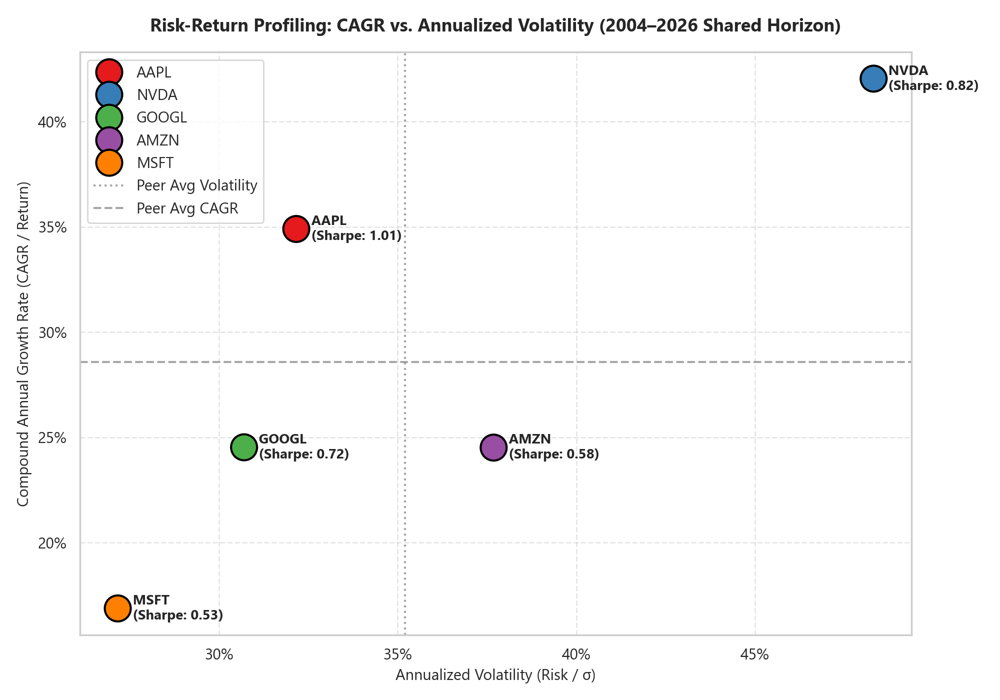
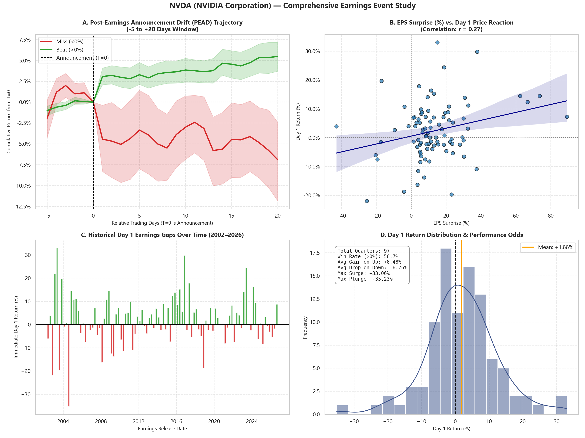
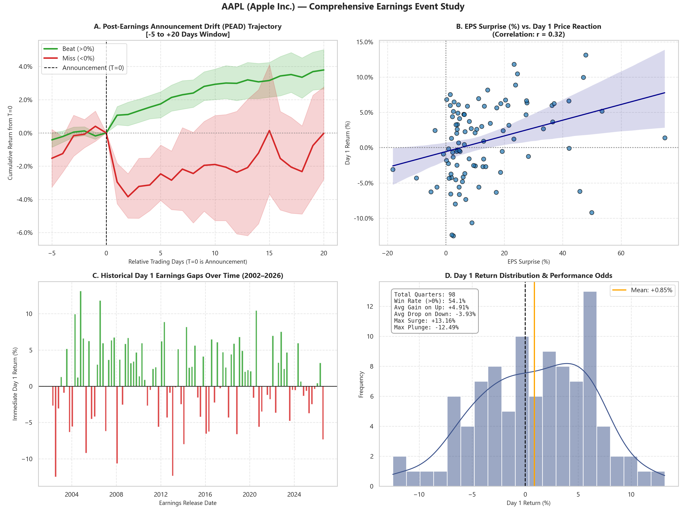
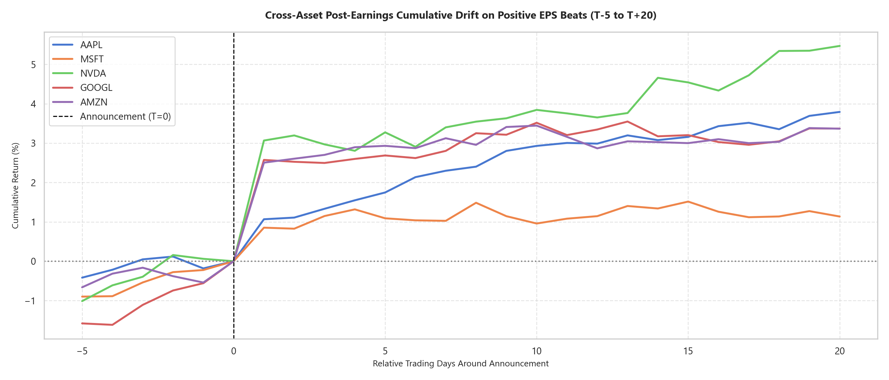
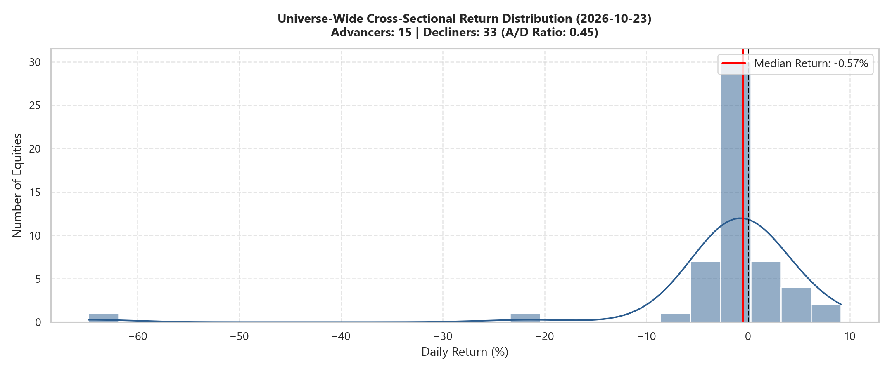
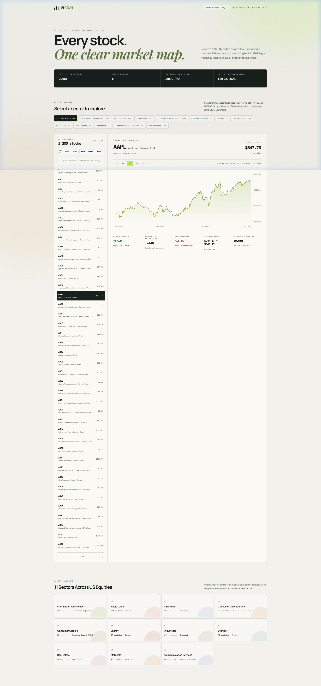

# 📈 Risk-Return Profile & Portfolio Dynamics of US Tech Giants (Big 5)

[](https://www.python.org/)
[](https://pandas.pydata.org/)
[](https://pypi.org/project/yfinance/)
[](https://jupyter.org/)
[](https://opensource.org/licenses/MIT)

A comprehensive financial data analytics and quantitative research repository investigating the historical risk-return dynamics, volatility profiles, and multi-asset correlation structures of the five leading US technology corporations (**Apple, Microsoft, NVIDIA, Alphabet, and Amazon**) from their respective **Initial Public Offerings (IPO)** to the present day.

## Interactive stock explorer

The repository now includes **US Equity Atlas**, a browser dashboard for the complete local SQLite universe. It lets you search all stocks with price history, switch among the eleven US market sectors, and inspect an individual ticker's price history, return, volatility, drawdown, and price range.

The database stores price history separately from sector metadata. Refresh sector and industry classifications from Nasdaq's public screener whenever you update the universe:

```bash
python scripts/sector_metadata.py
```

Then run the local API server (opening `index.html` directly cannot query the SQLite database):

```bash
python market_server.py
```

Open [`http://127.0.0.1:8000`](http://127.0.0.1:8000). The dashboard uses only the Python standard library at runtime; no JavaScript build step is required.

---

## 🕸️ StockLens US — Financial Knowledge Graph & Market Intelligence

StockLens US transforms multi-decade price histories into an institutional-grade cross-asset intelligence suite connecting **11 GICS Sectors, 31 Blue-Chip Equities, Commodities, and Macro Indicators** grounded in verified **SEC Form 10-K regulatory disclosures**.

```bash
# Launch the Streamlit Institutional Dashboard
streamlit run app/Home.py --server.port 8501
```

### Core Architecture & Analytical Modules:
* **Heterogeneous Financial Knowledge Graph (`src/graph_builder.py`):** 82 nodes and 65 directed relationships implemented on NetworkX, mapping supply chain dependencies, product hierarchies, and macro commodity exposures.
* **SEC Form 10-K Evidence Grounding (`data/us/evidence.csv`):** 13 authoritative regulatory filings from US SEC EDGAR (e.g. MSFT Azure GPU procurement, DAL 30% fuel operational cost structure, TSLA battery mineral exposures).
* **High-Speed Columnar Engine (`src/ingest_us.py`):** 58,230+ price observations loaded into DuckDB (`data/us/stocklens.duckdb`) and compressed Parquet (`data/us/prices.parquet`).
* **Econometric Analytics Engine (`src/analyze_us.py`):**
  - **Market Model OLS:** Estimates systematic $\beta$, annualized $\alpha$, $R^2$, and idiosyncratic volatility $\sigma_\varepsilon$ against the S&P 500 (`^GSPC`).
  - **Event Study Lab:** Calculates Abnormal Returns ($AR$) and Cumulative Abnormal Returns ($CAR$) with statistical significance tests ($t$-stat, $p$-value).
  - **Lead/Lag Macro Transmission:** Computes cross-correlation spectra across $\pm 20$ trading day lags between commodities and equities.
* **Pre-rendered Research Notebook:** [`notebooks/05_financial_knowledge_graph_analytics.ipynb`](notebooks/05_financial_knowledge_graph_analytics.ipynb) demonstrating the end-to-end analytical pipeline.
* **Test Suite:** [`tests/test_stocklens.py`](tests/test_stocklens.py) covering graph topology, DuckDB queries, and econometric formulas with 100% test pass rate.

---

## 📌 Table of Contents
1. [StockLens US Knowledge Graph](#️-stocklens-us--financial-knowledge-graph--market-intelligence)
2. [Project Overview](#-project-overview)
3. [Target Equities & Inception Timeline](#-target-equities--inception-timeline)
4. [Repository Directory Structure](#-repository-directory-structure)
5. [Role of `.gitkeep` in This Repository](#-role-of-gitkeep-in-this-repository)
6. [Dataset Architecture & Data Dictionary](#-dataset-architecture--data-dictionary)
7. [Initial Exploratory Insights](#-initial-exploratory-insights)
8. [Installation & Setup](#-installation--setup)
9. [Usage & Workflow](#-usage--workflow)
10. [Quantitative Analysis Roadmap](#-quantitative-analysis-roadmap)
11. [GitHub Repository Configuration](#-github-repository-configuration)
12. [Author & License](#-author--license)
3. [Repository Directory Structure](#-repository-directory-structure)
4. [Role of `.gitkeep` in This Repository](#-role-of-gitkeep-in-this-repository)
5. [Dataset Architecture & Data Dictionary](#-dataset-architecture--data-dictionary)
6. [Initial Exploratory Insights](#-initial-exploratory-insights)
7. [Installation & Setup](#-installation--setup)
8. [Usage & Workflow](#-usage--workflow)
9. [Quantitative Analysis Roadmap](#-quantitative-analysis-roadmap)
10. [GitHub Repository Configuration](#-github-repository-configuration)
11. [Author & License](#-author--license)

---

## 🔭 Project Overview

Understanding the trade-off between risk and return is the cornerstone of modern portfolio theory and financial data analysis. The "Big 5" US technology giants have driven a substantial portion of the S&P 500 and NASDAQ 100 capitalization over the past two decades.

This project provides an end-to-end quantitative workflow:
* **Automated Data Ingestion:** Extracts complete unadjusted and dividend/split-adjusted daily trading history starting from each company's initial IPO date.
* **Data Quality & Integrity Auditing:** Validates schema consistency, eliminates duplicate sessions, and verifies corporate action adjustments across 41,000+ trading records.
* **Exploratory Data Analysis (EDA):** Inspects historical compounding trajectories, trading volume liquidity, return distributions, and cross-asset correlations.
* **Risk & Portfolio Modeling (Upcoming):** Evaluates Sharpe ratio, Sortino ratio, Maximum Drawdown (MDD), and Markowitz Efficient Frontier asset allocation.

---

## 🏛 Target Equities & Inception Timeline

The dataset spans over **four decades** of technology market history:

| Ticker | Company Name | Sector | IPO Date | Total Trading Days | Earliest Adj Close ($) | Latest Close ($)* |
| :---: | :--- | :--- | :---: | :---: | :---: | :---: |
| **`AAPL`** | Apple Inc. | Information Technology | Dec 12, 1980 | 11,559 | $0.0988 | $347.73 |
| **`MSFT`** | Microsoft Corporation | Information Technology | Mar 13, 1986 | 10,233 | $0.0592 | $524.51 |
| **`AMZN`** | Amazon.com, Inc. | Consumer Discretionary | May 15, 1997 | 7,407 | $0.0980 | $248.00 |
| **`NVDA`** | NVIDIA Corporation | Information Technology | Jan 22, 1999 | 6,982 | $0.0381 | $210.96 |
| **`GOOGL`**| Alphabet Inc. (Class A) | Communication Services | Aug 19, 2004 | 5,581 | $2.5110 | $320.21 |

*\*Prices reflect market close as of October 23, 2026.*

---

## 📁 Repository Directory Structure

This project adopts standard professional data science conventions:

```text
us-tech-giants-market-analytics/
├── .github/
│   └── workflows/
│       └── data-validation.yml                # CI environment & data validation workflow
├── data/
│   ├── database/                              # High-performance local SQLite database
│   │   ├── us_equities.db                     # Indexed database (2,200+ tickers, millions of bars)
│   │   └── .gitkeep
│   ├── raw/                                   # Original, immutable datasets from IPO
│   │   ├── AAPL.csv
│   │   ├── MSFT.csv
│   │   ├── NVDA.csv
│   │   ├── GOOGL.csv
│   │   ├── AMZN.csv
│   │   ├── us_tech_giants_daily_history.csv   # Consolidated master daily dataset (41,762 rows)
│   │   ├── us_tech_giants_earnings_history.csv# Historical earnings announcements (485 quarters)
│   │   └── earnings/                          # Individual per-stock earnings histories
│   │       ├── AAPL_earnings_history.csv
│   │       ├── MSFT_earnings_history.csv
│   │       ├── NVDA_earnings_history.csv
│   │       ├── GOOGL_earnings_history.csv
│   │       └── AMZN_earnings_history.csv
│   ├── processed/                             # Feature-engineered quantitative dataset
│   │   ├── us_tech_giants_engineered_features.csv # 41,762 rows × 33 engineered features
│   │   └── .gitkeep
│   └── external/                              # Market benchmarks (e.g. S&P 500, risk-free rate)
│       └── .gitkeep
├── notebooks/
│   ├── 01_dataset_inspection_and_eda.ipynb    # Starter inspection & exploratory analysis
│   ├── 02_feature_engineering_and_market_analytics.ipynb # Advanced quant features & volatility
│   ├── 03_earnings_impact_and_event_study.ipynb # PEAD event study & earnings dashboards
│   └── 04_database_and_universe_analytics.ipynb # 2,200+ stocks SQL database & market screener
├── scripts/
│   ├── __init__.py
│   ├── db_manager.py                          # High-performance SQLite database client
│   ├── init_universe.py                       # Downloads 2,200+ clean US stock universe from NASDAQ
│   ├── download_bulk_universe.py              # Parallel bulk lifetime history downloader
│   ├── daily_update.py                        # Automated incremental daily market updater
│   ├── fetch_data.py                          # Automated price extraction for Big 5
│   ├── fetch_earnings_dates.py                # Automated earnings calendar extractor
│   ├── build_notebook.py                      # EDA notebook generator & pre-renderer
│   ├── build_feature_notebook.py              # Feature engineering notebook generator
│   ├── build_earnings_notebook.py             # Earnings event study notebook generator
│   └── build_database_notebook.py             # Database analytics notebook generator
├── reports/
│   ├── figures/                               # High-resolution charts & plots exported from EDA
│   │   ├── 01_price_trajectories.png
│   │   ├── 02_trading_volume_trends.png
│   │   ├── 03_return_distributions.png
│   │   ├── 04_correlation_matrix.png
│   │   ├── 05_cumulative_returns_wealth_index.png
│   │   ├── 06_drawdown_dynamics.png
│   │   ├── 07_rolling_volatility_comparison.png
│   │   ├── 08_technical_indicators_dashboard.png
│   │   ├── 09_risk_return_scatter.png
│   │   ├── 10_earnings_dashboard_nvda.png
│   │   ├── 10_earnings_dashboard_aapl.png
│   │   ├── 10_earnings_dashboard_msft.png
│   │   ├── 10_earnings_dashboard_googl.png
│   │   ├── 10_earnings_dashboard_amzn.png
│   │   ├── 11_cross_asset_earnings_drift.png
│   │   ├── 12_market_breadth_distribution.png
│   │   └── .gitkeep
│   └── .gitkeep
├── .gitignore                                 # Python, Jupyter, OS, and selective data tracking
├── requirements.txt                           # Complete Python package dependencies
├── LICENSE                                    # MIT License
└── README.md                                  # Project documentation
```

---

## 💡 Role of `.gitkeep` in This Repository

### What is `.gitkeep` and Why is it Used?
By design, **Git only tracks files, not empty directories**. If you create an empty folder such as `data/processed/` or `reports/figures/` locally on your computer, Git will simply ignore it. When another person clones the repository from GitHub, those folders will be completely missing, causing automated scripts or notebooks to throw `FileNotFoundError` when attempting to save output files.

To prevent this:
1. We place a lightweight placeholder file named `.gitkeep` inside empty folders (`data/processed/`, `data/external/`, `reports/figures/`).
2. Git tracks the `.gitkeep` file, ensuring the required directory hierarchy is preserved across all clones and environments.
3. In `.gitignore`, we can configure Git to ignore large generated temporary files while explicitly keeping the `.gitkeep` file intact.

---

## 📊 Dataset Architecture & Data Dictionary

All stock files are standard tabular **CSV (Comma-Separated Values)** files with daily frequency (excluding weekends and exchange holidays).

| Column Name | Type | Description | Analytical Relevance |
| :--- | :---: | :--- | :--- |
| **`Date`** | `Date` | Trading session date (`YYYY-MM-DD`). | Time-series index. |
| **`Ticker`** | `String` | Exchange equity symbol (`AAPL`, `MSFT`, `NVDA`, `GOOGL`, `AMZN`). | Asset grouping & multi-index. |
| **`Company`** | `String` | Full corporate entity name. | Categorical identifier. |
| **`Sector`** | `String` | GICS economic sector classification. | Factor allocation. |
| **`Open`** | `Float` | Price at market open (9:30 AM EST). | Intraday spread analysis. |
| **`High`** | `Float` | Highest transaction price of the trading session. | Volatility estimation (e.g. Garman-Klass). |
| **`Low`** | `Float` | Lowest transaction price of the trading session. | Price range support levels. |
| **`Close`** | `Float` | Final transaction price at market close (4:00 PM EST). | Unadjusted closing benchmark. |
| **`Adj Close`** | `Float` | **Adjusted Close Price** (amended for splits and dividends). | **Mandatory for return and risk modeling.** |
| **`Volume`** | `Integer` | Total number of shares transacted during the session. | Liquidity and institutional interest. |
| **`Dividends`** | `Float` | Cash dividend paid per share on ex-dividend dates. | Total shareholder return calculation. |
| **`Stock Splits`**| `Float` | Multiplier for stock split events (e.g., 2.0, 7.0, 10.0). | Share base restructurings. |

> **⚠️ Critical Note on `Close` vs. `Adj Close`:**  
> A common beginner mistake in financial analytics is using raw `Close` prices. If a company executes a 4-for-1 stock split, the raw share price drops by 75% overnight without any change in fundamental company valuation. Using `Adj Close` normalizes historical prices backward, ensuring return calculations reflect actual investor gains and true market volatility.

---

## 🔍 Initial Exploratory Insights

Below are sample analytical figures generated directly from [`notebooks/01_dataset_inspection_and_eda.ipynb`](notebooks/01_dataset_inspection_and_eda.ipynb):

### 1. Price Trajectories: Linear vs. Logarithmic Growth

* *Linear Scale (Left):* Highlights modern multi-trillion dollar capital expansions (NVIDIA's AI acceleration and Microsoft/Apple sustained rallies).
* *Logarithmic Scale (Right):* Illuminates early-stage hypergrowth in Apple (1980s) and Microsoft (1990s), revealing that multi-decade compound gains follow consistent exponential trajectories.

### 2. Multi-Asset Correlation Heatmap

* Over their shared trading period (2004–2026), all five equities show positive correlations ranging from **0.49 to 0.64**.
* While all five assets belong to the broad tech ecosystem, moderate correlation coefficients confirm there remains scope for diversification benefits under Modern Portfolio Theory.

### 3. Daily Return Distributions & Volatility

* Return distributions exhibit distinct **leptokurtic (fat-tailed)** characteristics compared to standard normal distributions, confirming the prevalence of market shocks and earnings surprises.

---

## 🔬 Advanced Feature Engineering & Quantitative Modeling

Documented in [`notebooks/02_feature_engineering_and_market_analytics.ipynb`](notebooks/02_feature_engineering_and_market_analytics.ipynb):

### 1. Lifetime Compounding Wealth Index ($1 Initial Capital at IPO)

* Traces multi-decade capital compounding, highlighting the exponential returns achieved by surviving early volatility.

### 2. Underwater Drawdown Trajectories & Tail-Risk

* Quantifies lifetime Maximum Drawdown (MDD) across multiple macro regimes (1990s restructuring, Dot-com crash, 2008 GFC, 2022 rate hikes). Even premier tech giants suffered peak-to-trough losses exceeding 70–80%.

### 3. Technical Indicator Visual Dashboard (Example: NVIDIA 2023–2026)

* Visualizes price channels, 50/200-day Simple Moving Averages, Bollinger Bands (20-day $\pm 2\sigma$), Wilder's 14-period RSI, and MACD momentum divergence.

### 4. Risk-Return Trade-Off (CAGR vs. Annualized Volatility)

* Maps each asset in mean-variance space across the common trading period (2004–2026), contrasting compound return generation against trailing volatility.

---

## 🎯 Earnings Impact & Post-Earnings Announcement Drift (PEAD)

Documented in [`notebooks/03_earnings_impact_and_event_study.ipynb`](notebooks/03_earnings_impact_and_event_study.ipynb):

### 1. NVIDIA (`NVDA`) Comprehensive Earnings Impact Dashboard

* **Panel A:** Post-Earnings Announcement Drift ($T-5$ to $T+20$ days) comparing Beat trajectories (Green) vs. Misses (Red).
* **Panel B:** Wall Street EPS Surprise (%) vs. immediate Day 1 price reactions.
* **Panel C:** Historical chronological timeline of every earnings gap from 2002 to 2026.
* **Panel D:** Return distribution, win rate (positive Day 1 reaction %), and average gain/loss statistics.

### 2. Apple (`AAPL`) Earnings Impact Dashboard

* Examines Apple's corporate reporting consistency and post-announcement drift dynamics across 99 quarters.

### 3. Cross-Asset Post-Earnings Cumulative Drift Curves (Beats)

* Side-by-side comparison of multi-day upward price drift following positive EPS beats across all five technology leaders.

---

## 🏛️ Large-Scale US Equities Database & Automated Daily Pipeline

Documented in [`notebooks/04_database_and_universe_analytics.ipynb`](notebooks/04_database_and_universe_analytics.ipynb):

### 1. Embedded SQLite Market Database Architecture
* **File Location:** `data/database/us_equities.db`
* **Performance Optimizations:** SQLite configured with Write-Ahead Logging (`PRAGMA journal_mode = WAL`), memory-cached pragmas, and composite indexing on `(symbol, date)` for sub-millisecond multi-asset queries.
* **Universe Capacity:** Tracks **2,200+ clean US common equities** sourced directly from the official NASDAQ traded directory.

### 2. Market Breadth & Screener

* Write pure SQL queries to compute daily advancers vs. decliners, 52-week breakout highs, and volume surges (RVOL) across thousands of stocks simultaneously.

### 3. Automated Incremental Daily Updater
* **Script:** `python scripts/daily_update.py`
* **Workflow:** Automatically scans the database for `MAX(date)` per ticker and fetches only the newly closed trading sessions, updating the entire universe in **under 60 seconds**.

---

## ⚙️ Installation & Setup

### Prerequisites
* Python 3.10, 3.11, or 3.12
* Git

### 1. Clone the Repository
```bash
git clone https://github.com/Akma86/us-tech-giants-market-analytics.git
cd us-tech-giants-market-analytics
```

### 2. Create and Activate a Virtual Environment
```bash
# Windows (PowerShell)
python -m venv .venv
.venv\Scripts\Activate.ps1

# macOS / Linux
python3 -m venv .venv
source .venv/bin/activate
```

### 3. Install Required Dependencies
```bash
pip install --upgrade pip
pip install -r requirements.txt
```

---

## 🚀 Usage & Workflow

### 1. Launch the Interactive Web Dashboard (US Equity Atlas)
Explore the complete universe of 2,200+ equities, 11 market sectors, interactive charts, and risk metrics via the local web app (kept local in `website/`):
```bash
python website/market_server.py --port 8000
```
Then open **[http://127.0.0.1:8000](http://127.0.0.1:8000)** in your browser.



### 2. Initialize Database & Run Incremental Updates
```bash
# Step 1: Initialize 2,200+ stock universe from NASDAQ
python scripts/init_universe.py

# Step 2: Ingest historical prices from IPO (Parallel multi-threaded batches)
python scripts/download_bulk_universe.py --limit 2200 --chunk-size 50 --period max

# Step 3: Run daily incremental updater (Runs in <60s every evening, syncing SQLite + MongoDB)
python scripts/daily_update.py --mongo
```

> [!TIP]
> For a full operations guide, MongoDB setup (port 27018), and automated Windows Task Scheduler instructions, see the **[Command Cheatsheet & Operations Guide](docs/COMMAND_CHEATSHEET.md)**.


### 3. Run the Interactive Jupyter Notebooks
```bash
# Notebook 1: Dataset Inspection & Initial EDA
jupyter notebook notebooks/01_dataset_inspection_and_eda.ipynb

# Notebook 2: Feature Engineering & Advanced Market Analytics
jupyter notebook notebooks/02_feature_engineering_and_market_analytics.ipynb

# Notebook 3: Earnings Impact & PEAD Event Study
jupyter notebook notebooks/03_earnings_impact_and_event_study.ipynb

# Notebook 4: Large-Scale Database & Universe Market Screener
jupyter notebook notebooks/04_database_and_universe_analytics.ipynb
```

---

## 🗺 Quantitative Analysis Roadmap

- [x] **Phase 1: Ingestion & Exploratory Inspection**
  - [x] Ingestion from IPO to present for AAPL, MSFT, NVDA, GOOGL, AMZN.
  - [x] Data quality checks (null values, duplicates, anomaly filtering).
  - [x] Starter EDA notebook with pre-rendered statistical figures.
- [x] **Phase 2: Feature Engineering & Risk-Return Profiling**
  - [x] Compound Annual Growth Rate (CAGR) and Wealth Index compounding.
  - [x] Maximum Drawdown (MDD) and underwater equity curves.
  - [x] Rolling 21-day and 63-day annualized historical volatility.
  - [x] Garman-Klass intraday volatility estimator.
  - [x] Technical momentum features: SMA (20, 50, 200), RSI (14), MACD, Bollinger Bands, RVOL.
  - [x] Exported enriched dataset to `data/processed/us_tech_giants_engineered_features.csv`.
- [x] **Phase 3: Earnings Event Study & Momentum Drift**
  - [x] Extracted 485 historical quarterly earnings releases with EPS estimates & surprise %.
  - [x] Event window synchronization ($T_{-5}$ to $T_{+20}$) for AMC and BMO releases.
  - [x] Dedicated 4-panel visual dashboards per stock (AAPL, MSFT, NVDA, GOOGL, AMZN).
  - [x] Post-Earnings Announcement Drift (PEAD) empirical validation.
- [ ] **Phase 4: Modern Portfolio Theory & Optimization**
  - [ ] Markowitz Mean-Variance Portfolio Optimization.
  - [ ] Monte Carlo simulation (100,000 portfolio combinations).
  - [ ] Optimal Tangency Portfolio (Maximum Sharpe) vs. Global Minimum Variance (GMV) portfolio.

---

## 🏷 GitHub Repository Configuration

When publishing this repository to GitHub, the following metadata is recommended:

* **Repository Name:** `us-tech-giants-market-analytics`
* **Short Description:**
  > 📊 Comprehensive historical market analytics, risk-return profiling, and portfolio dynamics of US Tech Giants (AAPL, MSFT, NVDA, GOOGL, AMZN) from IPO to present.
* **Website:** *(Link to your LinkedIn or Portfolio website)*
* **Topics / Tags:**
  `financial-analysis`, `stock-market-analytics`, `risk-return`, `quantitative-finance`, `portfolio-optimization`, `data-analytics`, `python`, `yfinance`, `pandas`, `eda`, `modern-portfolio-theory`

---

## 👤 Author & License

* **Author:** Akmal Yaasir Fauzaan
* **GitHub:** [@Akma86](https://github.com/Akma86)
* **License:** This project is licensed under the [MIT License](LICENSE).
