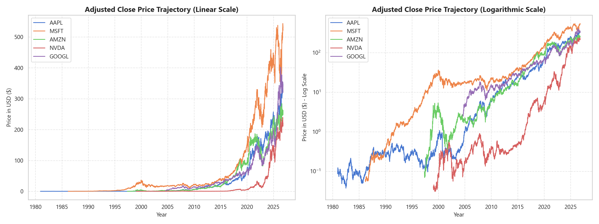
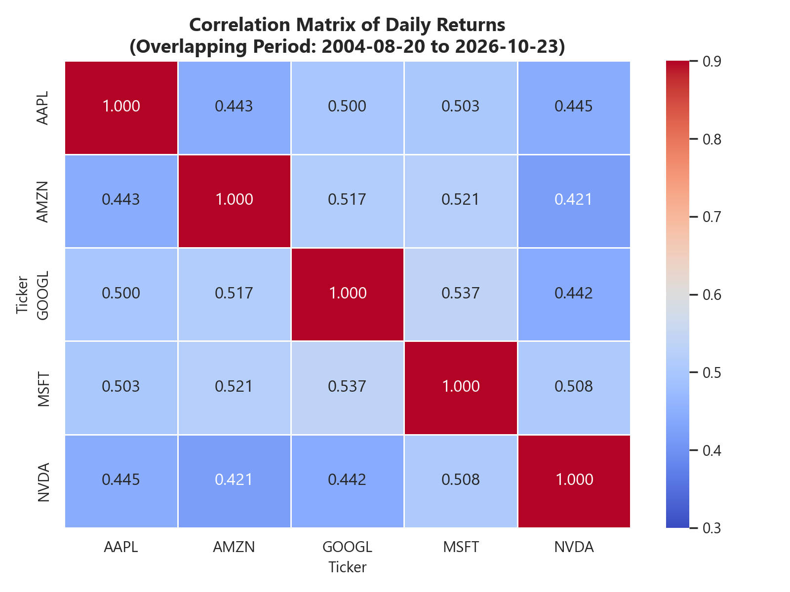
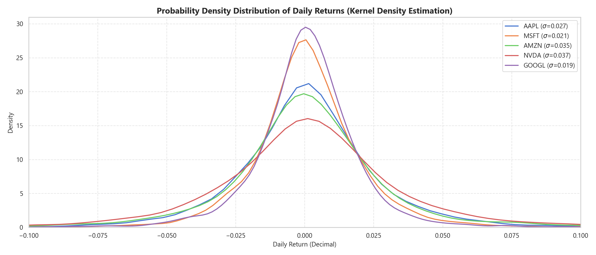

# 📈 Risk-Return Profile & Portfolio Dynamics of US Tech Giants (Big 5)

[](https://www.python.org/)
[](https://pandas.pydata.org/)
[](https://pypi.org/project/yfinance/)
[](https://jupyter.org/)
[](https://opensource.org/licenses/MIT)

A comprehensive financial data analytics and quantitative research repository investigating the historical risk-return dynamics, volatility profiles, and multi-asset correlation structures of the five leading US technology corporations (**Apple, Microsoft, NVIDIA, Alphabet, and Amazon**) from their respective **Initial Public Offerings (IPO)** to the present day.

---

## 📌 Table of Contents
1. [Project Overview](#-project-overview)
2. [Target Equities & Inception Timeline](#-target-equities--inception-timeline)
3. [Repository Directory Structure](#-repository-directory-structure)
4. [Role of `.gitkeep` in This Repository](#-role-of-gitkeep-in-this-repository)
5. [Dataset Architecture & Data Dictionary](#-dataset-architecture--data-dictionary)
6. [Initial Exploratory Insights](#-initial-exploratory-insights)
7. [Installation & Setup](#-installation--setup)
8. [Usage & Workflow](#-usage--workflow)
9. [Quantitative Analysis Roadmap](#-quantitative-analysis-roadmap)
10. [GitHub Repository Configuration](#-github-repository-configuration)
11. [Author & License](#-author--license)

---

## 🔭 Project Overview

Understanding the trade-off between risk and return is the cornerstone of modern portfolio theory and financial data analysis. The "Big 5" US technology giants have driven a substantial portion of the S&P 500 and NASDAQ 100 capitalization over the past two decades.

This project provides an end-to-end quantitative workflow:
* **Automated Data Ingestion:** Extracts complete unadjusted and dividend/split-adjusted daily trading history starting from each company's initial IPO date.
* **Data Quality & Integrity Auditing:** Validates schema consistency, eliminates duplicate sessions, and verifies corporate action adjustments across 41,000+ trading records.
* **Exploratory Data Analysis (EDA):** Inspects historical compounding trajectories, trading volume liquidity, return distributions, and cross-asset correlations.
* **Risk & Portfolio Modeling (Upcoming):** Evaluates Sharpe ratio, Sortino ratio, Maximum Drawdown (MDD), and Markowitz Efficient Frontier asset allocation.

---

## 🏛 Target Equities & Inception Timeline

The dataset spans over **four decades** of technology market history:

| Ticker | Company Name | Sector | IPO Date | Total Trading Days | Earliest Adj Close ($) | Latest Close ($)* |
| :---: | :--- | :--- | :---: | :---: | :---: | :---: |
| **`AAPL`** | Apple Inc. | Information Technology | Dec 12, 1980 | 11,559 | $0.0988 | $347.73 |
| **`MSFT`** | Microsoft Corporation | Information Technology | Mar 13, 1986 | 10,233 | $0.0592 | $524.51 |
| **`AMZN`** | Amazon.com, Inc. | Consumer Discretionary | May 15, 1997 | 7,407 | $0.0980 | $248.00 |
| **`NVDA`** | NVIDIA Corporation | Information Technology | Jan 22, 1999 | 6,982 | $0.0381 | $210.96 |
| **`GOOGL`**| Alphabet Inc. (Class A) | Communication Services | Aug 19, 2004 | 5,581 | $2.5110 | $320.21 |

*\*Prices reflect market close as of October 23, 2026.*

---

## 📁 Repository Directory Structure

This project adopts standard professional data science conventions:

```text
Risk-Return-US-Stock/
├── .github/
│   └── workflows/
│       └── data-check.yml            # CI validation workflow
├── data/
│   ├── raw/                          # Original, immutable datasets
│   │   ├── AAPL.csv
│   │   ├── MSFT.csv
│   │   ├── NVDA.csv
│   │   ├── GOOGL.csv
│   │   ├── AMZN.csv
│   │   └── us_tech_giants_daily_history.csv  # Consolidated master dataset (41,762 rows)
│   ├── processed/                    # Feature-engineered / cleaned outputs
│   │   └── .gitkeep                  # Preserves directory in Git
│   └── external/                     # Market benchmarks (e.g. S&P 500, risk-free rate)
│       └── .gitkeep                  # Preserves directory in Git
├── notebooks/
│   └── 01_dataset_inspection_and_eda.ipynb   # Starter inspection & exploratory analysis
├── scripts/
│   ├── __init__.py
│   ├── fetch_data.py                 # Automated data extraction from Yahoo Finance
│   └── build_notebook.py             # Notebook generator & pre-renderer
├── reports/
│   ├── figures/                      # High-resolution charts & plots exported from EDA
│   │   ├── 01_price_trajectories.png
│   │   ├── 02_trading_volume_trends.png
│   │   ├── 03_return_distributions.png
│   │   ├── 04_correlation_matrix.png
│   │   └── .gitkeep
│   └── .gitkeep
├── .gitignore                        # Python, Jupyter, OS, and selective data tracking
├── requirements.txt                  # Complete Python package dependencies
├── LICENSE                           # MIT License
└── README.md                         # Project documentation
```

---

## 💡 Role of `.gitkeep` in This Repository

### What is `.gitkeep` and Why is it Used?
By design, **Git only tracks files, not empty directories**. If you create an empty folder such as `data/processed/` or `reports/figures/` locally on your computer, Git will simply ignore it. When another person clones the repository from GitHub, those folders will be completely missing, causing automated scripts or notebooks to throw `FileNotFoundError` when attempting to save output files.

To prevent this:
1. We place a lightweight placeholder file named `.gitkeep` inside empty folders (`data/processed/`, `data/external/`, `reports/figures/`).
2. Git tracks the `.gitkeep` file, ensuring the required directory hierarchy is preserved across all clones and environments.
3. In `.gitignore`, we can configure Git to ignore large generated temporary files while explicitly keeping the `.gitkeep` file intact.

---

## 📊 Dataset Architecture & Data Dictionary

All stock files are standard tabular **CSV (Comma-Separated Values)** files with daily frequency (excluding weekends and exchange holidays).

| Column Name | Type | Description | Analytical Relevance |
| :--- | :---: | :--- | :--- |
| **`Date`** | `Date` | Trading session date (`YYYY-MM-DD`). | Time-series index. |
| **`Ticker`** | `String` | Exchange equity symbol (`AAPL`, `MSFT`, `NVDA`, `GOOGL`, `AMZN`). | Asset grouping & multi-index. |
| **`Company`** | `String` | Full corporate entity name. | Categorical identifier. |
| **`Sector`** | `String` | GICS economic sector classification. | Factor allocation. |
| **`Open`** | `Float` | Price at market open (9:30 AM EST). | Intraday spread analysis. |
| **`High`** | `Float` | Highest transaction price of the trading session. | Volatility estimation (e.g. Garman-Klass). |
| **`Low`** | `Float` | Lowest transaction price of the trading session. | Price range support levels. |
| **`Close`** | `Float` | Final transaction price at market close (4:00 PM EST). | Unadjusted closing benchmark. |
| **`Adj Close`** | `Float` | **Adjusted Close Price** (amended for splits and dividends). | **Mandatory for return and risk modeling.** |
| **`Volume`** | `Integer` | Total number of shares transacted during the session. | Liquidity and institutional interest. |
| **`Dividends`** | `Float` | Cash dividend paid per share on ex-dividend dates. | Total shareholder return calculation. |
| **`Stock Splits`**| `Float` | Multiplier for stock split events (e.g., 2.0, 7.0, 10.0). | Share base restructurings. |

> **⚠️ Critical Note on `Close` vs. `Adj Close`:**  
> A common beginner mistake in financial analytics is using raw `Close` prices. If a company executes a 4-for-1 stock split, the raw share price drops by 75% overnight without any change in fundamental company valuation. Using `Adj Close` normalizes historical prices backward, ensuring return calculations reflect actual investor gains and true market volatility.

---

## 🔍 Initial Exploratory Insights

Below are sample analytical figures generated directly from [`notebooks/01_dataset_inspection_and_eda.ipynb`](notebooks/01_dataset_inspection_and_eda.ipynb):

### 1. Price Trajectories: Linear vs. Logarithmic Growth

* *Linear Scale (Left):* Highlights modern multi-trillion dollar capital expansions (NVIDIA's AI acceleration and Microsoft/Apple sustained rallies).
* *Logarithmic Scale (Right):* Illuminates early-stage hypergrowth in Apple (1980s) and Microsoft (1990s), revealing that multi-decade compound gains follow consistent exponential trajectories.

### 2. Multi-Asset Correlation Heatmap

* Over their shared trading period (2004–2026), all five equities show positive correlations ranging from **0.49 to 0.64**.
* While all five assets belong to the broad tech ecosystem, moderate correlation coefficients confirm there remains scope for diversification benefits under Modern Portfolio Theory.

### 3. Daily Return Distributions & Volatility

* Return distributions exhibit distinct **leptokurtic (fat-tailed)** characteristics compared to standard normal distributions, confirming the prevalence of market shocks and earnings surprises.

---

## ⚙️ Installation & Setup

### Prerequisites
* Python 3.10, 3.11, or 3.12
* Git

### 1. Clone the Repository
```bash
git clone https://github.com/Akma86/Risk-Return-US-Stock.git
cd Risk-Return-US-Stock
```

### 2. Create and Activate a Virtual Environment
```bash
# Windows (PowerShell)
python -m venv .venv
.venv\Scripts\Activate.ps1

# macOS / Linux
python3 -m venv .venv
source .venv/bin/activate
```

### 3. Install Required Dependencies
```bash
pip install --upgrade pip
pip install -r requirements.txt
```

---

## 🚀 Usage & Workflow

### 1. Refresh or Download Historical Market Data
To re-fetch the latest live prices from IPO to today:
```bash
python scripts/fetch_data.py
```
This updates all individual CSVs in `data/raw/` and generates the consolidated `us_tech_giants_daily_history.csv`.

### 2. Launch the Interactive Jupyter Notebook
```bash
jupyter notebook notebooks/01_dataset_inspection_and_eda.ipynb
```
Follow along step-by-step to inspect data types, sanity checks, distribution curves, and interactive visualizations.

---

## 🗺 Quantitative Analysis Roadmap

- [x] **Phase 1: Ingestion & Exploratory Inspection**
  - [x] Ingestion from IPO to present for AAPL, MSFT, NVDA, GOOGL, AMZN.
  - [x] Data quality checks (null values, duplicates, anomaly filtering).
  - [x] Starter EDA notebook with pre-rendered statistical figures.
- [ ] **Phase 2: Risk-Return Performance Metrics**
  - [ ] Compound Annual Growth Rate (CAGR) across market cycles.
  - [ ] Maximum Drawdown (MDD) and recovery durations (Dot-Com, 2008 GFC, 2020 COVID, 2022 Fed rate hikes).
  - [ ] Rolling 30-day and 252-day annualized historical volatility.
- [ ] **Phase 3: Risk-Adjusted Benchmarking**
  - [ ] Sharpe Ratio and Sortino Ratio computation using historical US Treasury risk-free rates.
  - [ ] Beta and Alpha estimation relative to S&P 500 (`^GSPC`) benchmark.
  - [ ] Value at Risk (VaR) and Conditional VaR (Expected Shortfall) at 95% and 99% confidence.
- [ ] **Phase 4: Modern Portfolio Theory & Optimization**
  - [ ] Markowitz Mean-Variance Portfolio Optimization.
  - [ ] Monte Carlo simulation (100,000 portfolio combinations).
  - [ ] Optimal Tangency Portfolio (Maximum Sharpe) vs. Global Minimum Variance (GMV) portfolio.

---

## 🏷 GitHub Repository Configuration

When publishing this repository to GitHub, the following metadata is recommended:

* **Repository Name:** `Risk-Return-US-Stock`
* **Short Description:**
  > Comprehensive historical risk-return analysis, volatility modeling, and portfolio dynamics of US Tech Giants (AAPL, MSFT, NVDA, GOOGL, AMZN) from IPO to present.
* **Website:** *(Link to your LinkedIn or Portfolio website)*
* **Topics / Tags:**
  `financial-analysis`, `risk-return`, `quantitative-finance`, `stock-market`, `portfolio-optimization`, `data-analytics`, `python`, `yfinance`, `pandas`, `eda`, `modern-portfolio-theory`

---

## 👤 Author & License

* **Author:** Akmal Yaasir Fauzaan
* **GitHub:** [@Akma86](https://github.com/Akma86)
* **License:** This project is licensed under the [MIT License](LICENSE).
